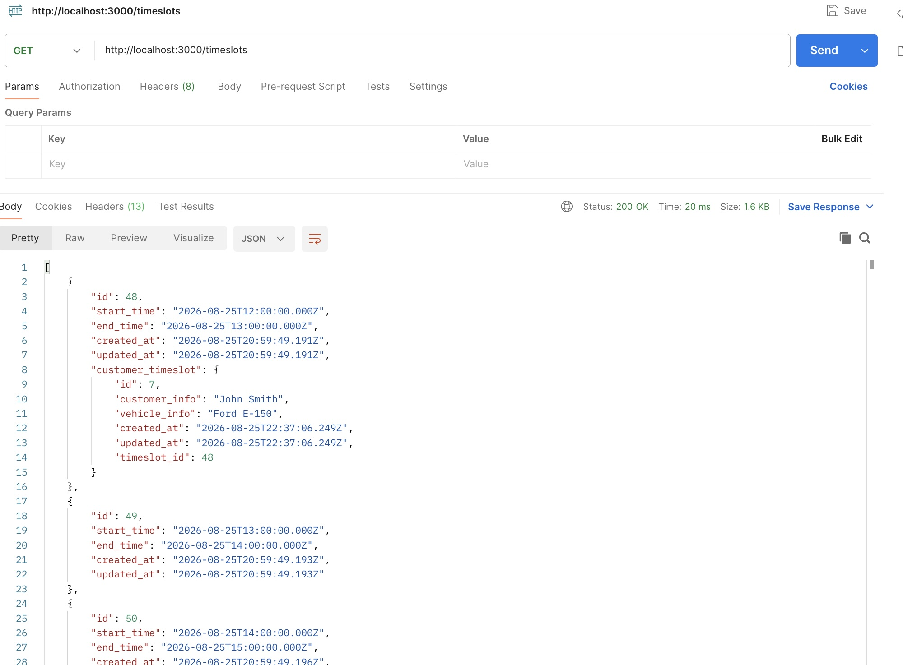
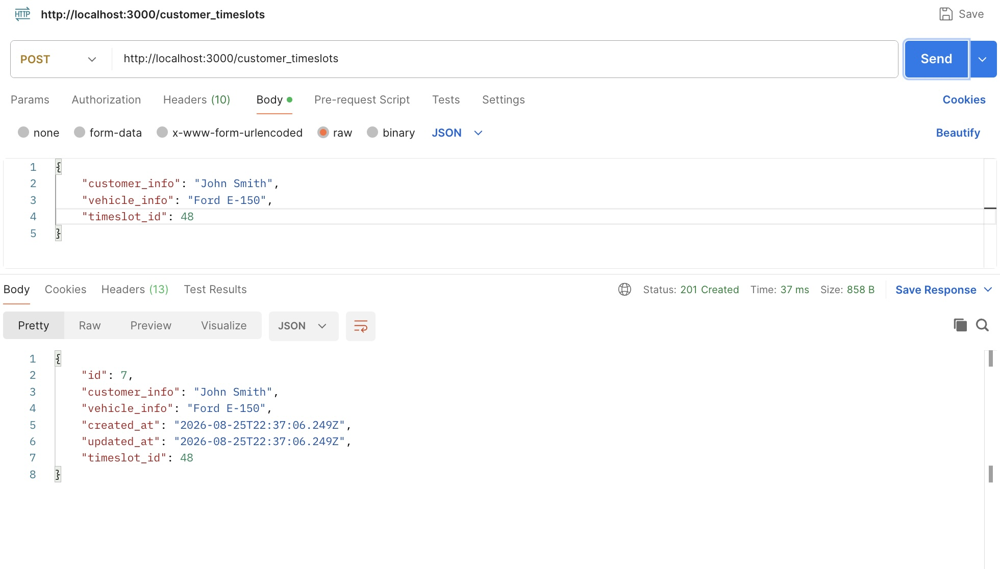
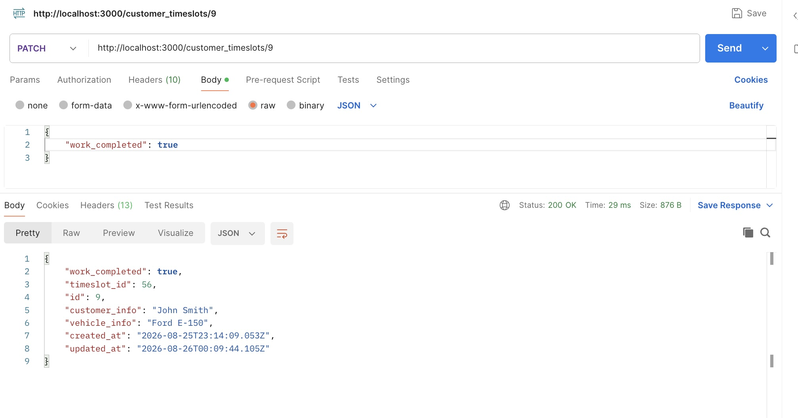
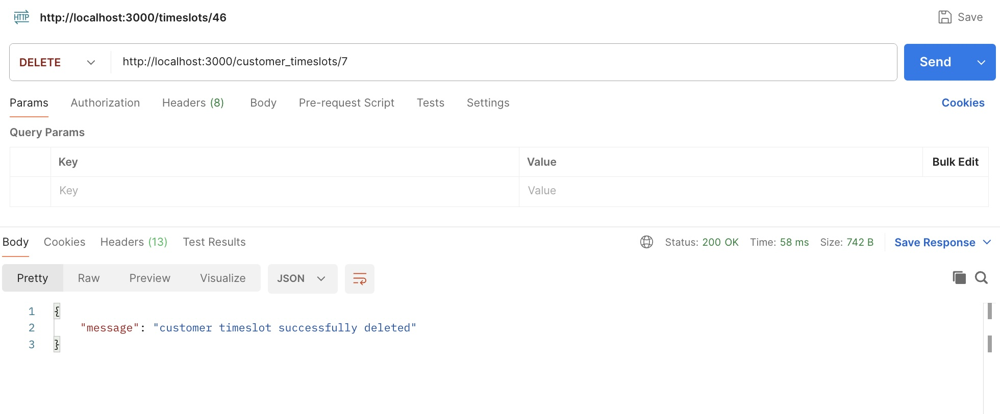
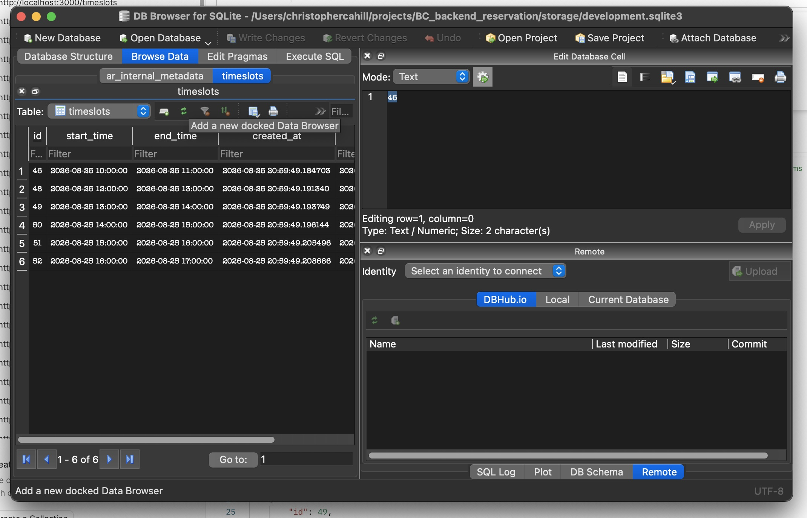

## BizzyCar Technical Assessment - Backend (RoR)

### Architecture Decisions
- Keeping DB simple with zero-config SQLite
- Assume every appointment (Timeslot) is one-hour in duration
- Seed database with a function that creats 8x 1-hour long Timeslot on that calendar day
  - If some Timeslots are deleted, re-running the seed ($ rails db:seed), will re-create the deleted Timeslots
- Keep models small and simple 
  - Timeslot: id, start_time(datetime), end_time(datetime), created_at(datetime), updated_at(datetime)
  - CustomerTimeslot: id, customer_info(varchar), vehicle_info(varchar), created_at(datetime), updated_at(datetime), timeslot_id(int references Timeslot), work_completed(boolean)
- Add basic functionality to create CustomerTimeslots, delete CustomerTimeslots, and delete Timeslots.
- I used a basic GET Index for the timeslots_controller, as I figured there would be some sort of dashboard UI representing a day's work that this data would feed into.

### Local Config and Setup for This Project
- $ bundle install
- $ rails db:migrate
- $ rails db:seed 
  - this command will create 8x, 1-hr timeslots for the current day running the hours of 0900-1700 (in UTC)
- $ rails server

### How To Use This App (locally)

- GET http://localhost:3000/timeslots
  - After running the above install, config, and seeding commands, the endpoint will give you the Timeslots, with CustomerTimeslots included as well:
  - 
- POST http://localhost:3000/customer_timeslots
  - Once you have the ID of an available timeslot, use the endpoint to book an appointment (customer_timeslot) with the following JSON body
    ```json
    {
      "customer_info": "John Smith",
      "vehicle_info": "Ford E-150",
      "timeslot_id": 48
    }
    ```
  - 
  
- PATCH http://localhost:3000/customer_timeslots/:customer_timeslot_id
  - We can update once work is completed for a CustomerTimeslot via the route above with following JSON:
    ```json
    {
      "work_completed": true
    }
    ```
  - 

- If you want to delete any of the Timeslot records (say during lunch hour, or for other business reasons):
  - DELETE http://localhost:3000/timeslots/:timeslot_id
    - if that timeslot exists, it will be deleted (along with an associated CustomerTimeslot, if there is one)
- If you want to delete any CustomerTimeslot (maybe someone canceled, etc.):
  - DELETE http://localhost:3000/customer_timeslots/:customer_timeslot_id
- 
- If you want to delete all Timeslots and CustomerTimeslots and start over with fresh Timeslot data:
  - (in rails console) $ Timeslot.destroy_all
  - (in project root bash) $ rails db:seed

### Testing (RSpec)
- I am using RSpec for testing the controllers in this app
- I did not add unit tests for models since they are so small
- The test suite can be run via:
  - $ bundle exec rspec
  or, for verbose results: 
  - $ bundle exec rspec --format documentation

- For GUI-assistance to see the records easily, I used DB Browser for SQLite, which you can install with the following command 
  - $ brew install --cask db-browser-for-sqlite
- After installation, simply click "Open Database", and open the .sqlite3 file located in storage/development.sqlite3
  - see below example: 
  - 

### Relevant Library Versions
* Ruby 3.4.7
* Rails 8.1.3.1
* SQLite 2.1
* Rspec for unit tests
* Rubocop for linting

### Ai Usage
- I utilized Claude Code throughout the development of this app. I mostly used Claude to create some boilerplate for the first model (timeslots), and then copied and pasted a bit.
- I additionally used Claude for a bit of the controller code, which for certain routes I then copied and pasted.
- I heavily used Claude to write the rspec tests against the controllers, and focused more of my manual (Postman) testing on application code.

### Future Improvements
- I tried to keep my time on this project to 3-4 hours, over a few days. With more time I would have included: 
  - Auth
  - Allow timeslots over multiple days
  - Paginate results over multiple days for front end consumption
  - Seed db with options for vehicle info (i.e. dropdown)
  - Mailer info once a CustomerTimeslot has been completed
